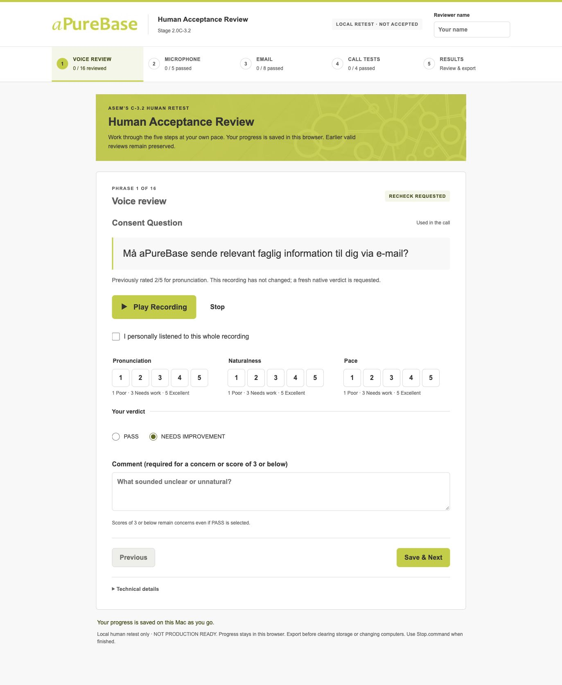
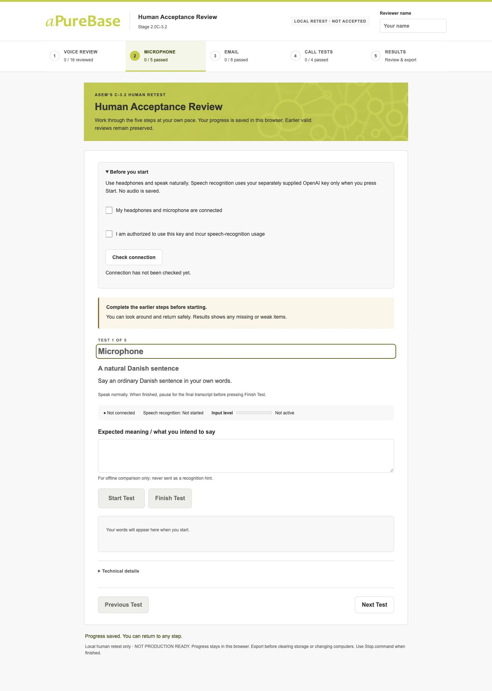
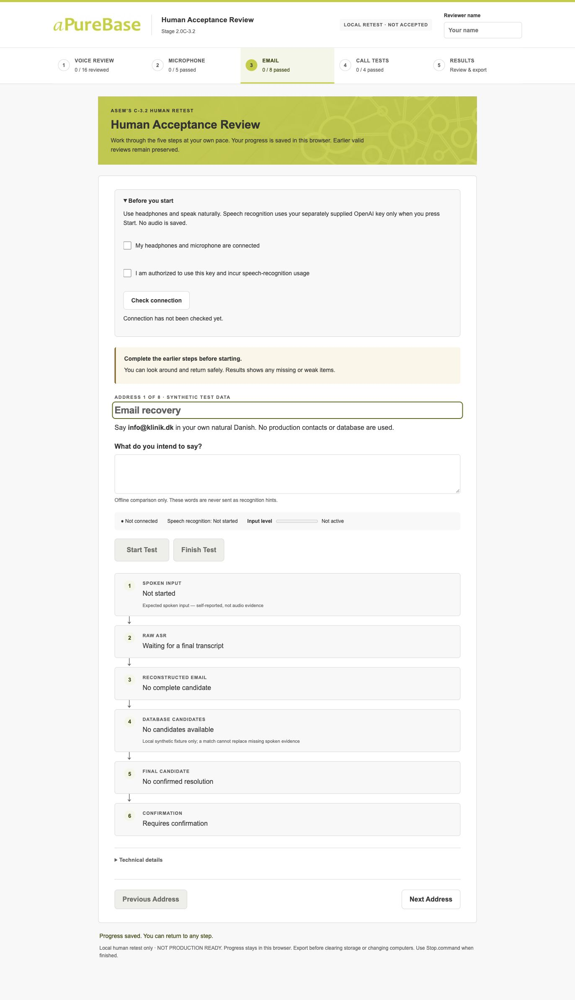
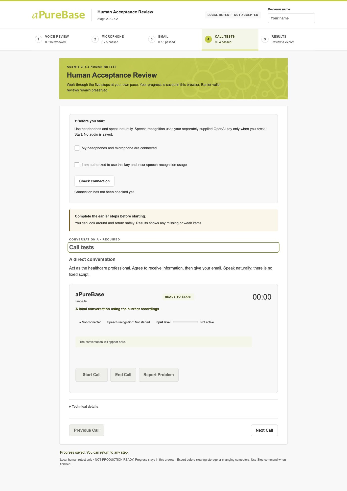
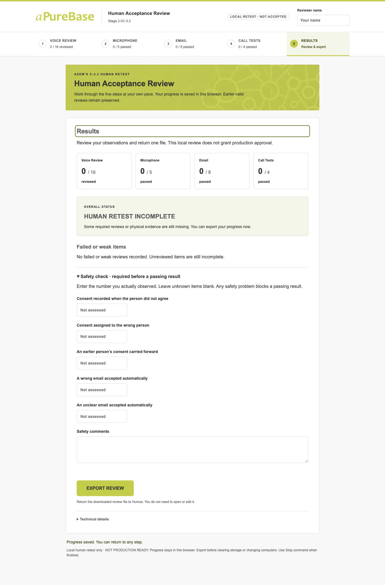

# aPureBase C-3.2 brand UI completion and verification

**aPureBase BRAND UI READY FOR REVIEW**

The five-step human-review application is now aligned with the supplied original aPureBase material. C-3.2 remains **NOT ACCEPTED / NOT PRODUCTION READY**. This is a human retest candidate, with no new physical provider or pronunciation acceptance evidence.

## Delivered package

Use this branded package for the next review; the earlier unbranded ZIP remains preserved as historical evidence.

- ZIP: `/Users/humzamazhar/Downloads/aPureBase-C32-Asem-Branded-Human-Retest.zip`
- ZIP SHA-256: `b26aabba1aba4a665aae828113188e6d3ceec44cb08c5530968b2420a1dde4ab`
- Size: 91,863,946 bytes (about 91.9 MB).
- Checksum sidecar: `/Users/humzamazhar/Downloads/aPureBase-C32-Asem-Branded-Human-Retest.zip.sha256`.
- Base commit: `c647dec9c6caae97b7b7e17d99283f9f402727c9`.
- Validated core hash: `cda13e62d921062f0a734589e992b460d643ef2c912c5d5436eb08fed6c82eea` — unchanged from the pre-brand candidate.
- Handoff hash: `a0a0920e93a4da6180da52b4fb0db72c12682963d74621c228db1620642e93b2`.
- Combined candidate/source hash: `d157a64eb1151de1681c99db087160d3945d5caf7ab2916fa88d2ca78941bcb0`.
- Package version: `stage-2.0c32-consolidated-human-retest-2`; uncommitted work remains included in this identity. The base commit alone does not identify the candidate.

The ZIP was built, cleanly extracted with macOS ditto, and tested from `/private/tmp/c32-brand-source/clean-extracted/aPureBase-C32-Asem-Branded-Retest`. Its 68 files include the original graphics, source/token report, local application, 38 current audio bindings backed by 37 distinct current recordings, launchers and both Mac runtimes. All sixteen required pending listening items remain bound to the authoritative current-assets table.

## Source documents inspected

- E-Consents v2.pptx
- E-Permission Communication Document Template.docx
- E-Permission Template.docx
- E-consent Nordics Feb 15 2021.pdf
- E-consent Nordics Feb 15 2021.pptx
- Email Consent Collection Nordics Abbott Feb 12 2021.pptx
- Email Consent Collection Nordics Abbott Feb 15 2021.pptx
- Email Consent Methodology 2021 Nordics Abbott.pptx
- aPureBase E-mail Consent Methodology_2021-02-16_Nordics_Abbott.pdf

See `../stage-2.0c-3.2-apurebase-brand-source.md` for the source → observed feature → token/asset mapping, source hashes, exact inspection methods and font limitations. See `../stage-2.0c-3.2-apurebase-brand-tokens.json` for machine-readable provenance/classifications. These two reports are also inside the ZIP as BRAND-SOURCE.md and BRAND-TOKENS.json.

The methodology PDF and editable methodology PowerPoint are the primary visual authorities. Related original decks corroborate lime banners, white working areas, grey text and molecular imagery. The Word communication templates use a separate generic blue header treatment; this was inspected and not adopted as the primary aPureBase brand. Generated project screenshots, AI concept colors and the invented aP monogram were excluded as brand sources.

## Original logo and graphical assets

The wordmark uses unchanged original JPEG bytes from `Email Consent Methodology 2021 Nordics Abbott.pptx`, `ppt/media/image3.jpg`. These are byte-identical to the repository's existing `public/apurebase-logo.jpg`.

Logo SHA-256: `54049e9513e608407635aa6effe7c7afd19ee140795b80a70d8edb951ab8232e`.

Original dimensions are 250×59 pixels. The desktop UI renders 210×49.55 pixels with automatic height and preserved white clear space; no recoloring, redrawing, stretching or invented typography. No original vector or higher-resolution wordmark was found in the supplied materials. The inspected SVG files were icons rather than logos.

The molecular JPEG comes from methodology PDF page 4, Image53 (1200×210). The original PDF overlays the image with a lime rectangle using normal blend and alpha 0.90196. The UI reproduces this exact source layering. A first visual iteration exposed the neutral underlying JPEG; that incomplete composition was corrected before sealing. Both iterations are retained in the private QA workspace. No new image or illustration was generated.

## Palette, typography and accessibility

- Source-exact primary: **#C2CD23**, taken from original PPTX accent1 and cross-checked against PDF fills.
- Source-exact **#B0BA1F** is reused for the hover state; the value is original, while its assignment to hover is a UI choice, not a claim of an official hover specification.
- Source-exact **#FFFFFF** surfaces and **#5F5F5F** grey text/headings.
- **#F4F6E8** pale green and **#F8F8F8** neutral background are explicitly SOURCE_SAMPLED, reproducible approximations of source fills rather than official documented HEX values.
- Accessibility-derived text **#333333**, focus **#626A12**, badge/selected-label **#43490D** and disabled text **#6B6B65** are explicitly UI_DERIVED_ACCESSIBILITY.
- Restrained amber/red and related status surfaces are SEMANTIC_UI_COLOR. They do not replace or overpower the actual lime identity.

All exact values and classifications are in the token report. The font stack follows observed Calibri/Candara characteristics with compatible system fallbacks. No claim of an official font specification or redistribution of Microsoft fonts is made. Danish æ/ø/å and uppercase variants remain supported.

Calculated contrast: primary dark text on lime **7.25:1**, hover **5.95:1**, source-grey text on white **6.385:1**, focus outline on white **5.85:1**. The minimum calculated text contrast over every original banner pixel after source alpha composition is **6.438:1**. Flat semantic text/surface pairs exceed 4.5:1. These checks are not a blanket accessibility certification.

The five screens were visually rendered and inspected at a **1373×922 desktop viewport**, within the requested laptop range. Logo proportions, no horizontal document overflow, readable hierarchy, large controls, labels, keyboard/Enter navigation, visible dark-green focus, non-color status labels and the skip link were checked. Responsive CSS remains in place below desktop widths; native testing on every browser/device and Intel Mac was not performed.

## Exact source changes in the brand pass

Relative to the completed pre-brand human-test UI candidate `929af7f4c86b88be23d5cca95d9eb54fedec6d959321c2902984780c8fbafa60`:

| File | Change |
| --- | --- |
| `docs/stage-2.0c-3.2-apurebase-brand-source.md` | ADDED |
| `docs/stage-2.0c-3.2-apurebase-brand-tokens.json` | ADDED |
| `scripts/stage20c32-handoff/START-HERE.txt` | MODIFIED |
| `scripts/stage20c32-package.ts` | MODIFIED |
| `src/consent/stage32/handoff/App.tsx` | MODIFIED |
| `src/consent/stage32/handoff/brand/apurebase-molecular-header.jpg` | ADDED |
| `src/consent/stage32/handoff/brand/apurebase-wordmark.jpg` | ADDED |
| `src/consent/stage32/handoff/style.css` | MODIFIED |
| `tests/consent-stage20c32-package-brand.test.tsx` | ADDED |

App changes are limited to importing the original logo and static logo/header/intro markup. CSS changes replace the concept palette and reproduce original source styling. The builder change packages the two source/provenance reports; it does not add provider behavior. START-HERE identifies the correct branded page. The new test file is presentation-only. The separate verification directory holds logs/screenshots/technical exports and does not modify any historical reports.

The complete App behavior prefix before the final page JSX, contract, live adapter, gating/presentation helpers, backend host, export verifier and JSON schema are byte-identical to the pre-brand snapshot. The 347 validated core source records remain unchanged. This proves the branding pass did not change consent rules, email reconstruction/resolution/ownership, ASR settings, state machines, audio, Isabella, phrase binding, evidence schema or backend behavior.

The earlier human-test UI task added the requested wizard, post-call review fields and persistence before this branding request. That prior UI candidate's behavior is the baseline for this visual-only pass. No existing unrelated tests were changed for branding.

## Final automated results

| Check | Result |
| --- | --- |
| c32-focused | 610/610 PASS |
| c31 | 139/139 PASS |
| prior-consent | 496/496 PASS |
| full | 1730/1730 PASS |
| lint | PASS |
| typecheck | PASS |
| build | PASS |
| c32-build | PASS |
| handoff-build | PASS |
| preservation-c31 | PASS |
| preservation-c32 | PASS |
| package-hashes | PASS |

The final C32 focused count is **610/610** and full-suite count **1,730/1,730**. The source-brand file adds nine tests; the prior human-interface file contains twenty. Their presentation-only subset is 29/29; the seventeen original package contract tests also pass. Asset-selection, email architecture and consent regressions are included. No retries, skipped tests, timeout increases or weakened assertions were introduced.

Builds retain Vite's nonblocking >500 kB bundle warning (the handoff bundle is roughly 660 kB). No unrelated optimization was performed. Existing C-3.1/C-3.2 preservation verifiers pass, including Stage 1.9.6 streaming, 37 original recordings, 12 C-3.1 recordings and three C-3.2 recordings. All 52 protected source recordings remain unchanged.

## Clean-extracted package and browser verification

- Manifest/source/permissions checks pass; all 38 current cached-media bindings were retrieved over localhost and hashed. Displayed/catalog/packaged-WAV/playback-target equality remains verified for all sixteen pending listening items.
- Fresh cached playback of **Why Calling, Success Close and Clarify** reached genuine WebAudio source-ended in the final branded ZIP with the required current hashes. This is technical playback evidence only. The preceding pre-brand UI had also completed all sixteen playback checks; those records retain their own distinct source identity and are not relabelled as branded evidence.
- All five actual branded screens were visually inspected. The screenshots below are real idle/gated UI, not fabricated live-ASR or natural-call screens. All human review counts remain zero.
- The browser's actual Export Review download validates using bundled `verify-review.mjs` against this exact candidate. Overall result is **HUMAN_RETEST_INCOMPLETE**. Listening/microphone/email/natural-call observations are all empty, and stageAccepted/productionReady remain false. Technical reviewer name is explicitly not Asem. The technical export is kept outside the handoff ZIP.
- Start.command, normal automatic browser opening, provider-free health, Stop.command, real restart and saved Results/reviewer resume pass on this Apple Silicon Mac. Official checksum-verified arm64/x64 runtimes are bundled. Native Intel execution remains untested.
- Verification-only mode strips/ignores provider credentials; health reports configured=false and no provider request. Manual ASR arming is rejected in this mode. No Start Test/Start Call action or microphone permission was exercised during construction.
- Source/ZIP bytes and the Downloads copy match the reported checksum. Whitespace and secret-pattern checks pass, with no .env, credentials, private recordings or private ignored caches packaged. The main checkout remains clean at the base commit. Local verification server was stopped after checks.

## Remaining human/business gates and stop status

Asem's sixteen native listening reviews, five genuine live microphone/ASR tests, eight synthetic spoken-email cases, required natural calls A–D (optional E if performed), actual timing/quality observations and explicit zero-safety-failure assessment remain pending. Native Danish quality, physical ASR accuracy, speech-recognition latency and call duration have not been proven by these automated checks.

All twelve business decisions from the existing acceptance index remain pending, including eight-day behavior, effective/suppression timing, system of record/retention, recording policy, unsubscribe, stored-email shortcut, production confirmation and intermediary authority. Real CRM/telephone integration and production readiness remain unverified.

**Zero OpenAI/ElevenLabs/live-ASR requests, zero additional audio generation, zero telephone calls. No commit, push, PR update, merge, deploy, Stage 2.0D or contact with Asem.**

The historical earlier ZIP in Downloads remains byte-identical. Use only the new branded ZIP for the next review. Asem unzips it, reads START-HERE.txt, supplies an authorized ASR key locally only when ready for the separately authorized physical tests, runs Start.command, completes the five steps, exports the review and returns it to Humza. No ElevenLabs credentials or TTS generation are needed.

## Screenshots of all five main screens

These were captured from the final clean-extracted branded package before entering any human observations.

### Voice Review

### Microphone

### Email Resolution

### Call Simulation

### Results

