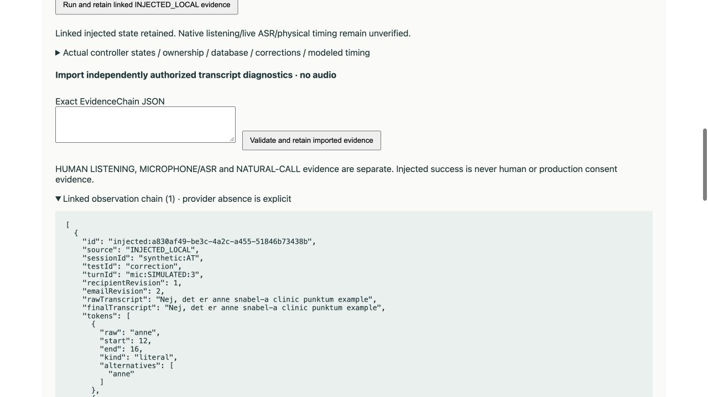

READY TO COMMIT — C-3.2 HUMAN RETEST CANDIDATE

Engineering remediation and local verification are complete. C-3.2 is NOT ACCEPTED and NOT PRODUCTION READY. No human test was requested or performed. This report authorizes no next action.

## Gap closure

| Gap | Engineering disposition | Change |
|---|---|---|
| GAP-001 | CLOSED | One public/default hardened policy |
| GAP-002 | CLOSED | Strict fail-closed database provenance |
| GAP-003 | CLOSED | Observed session safety metrics |
| GAP-004 | CLOSED | Lifecycle-connected visible preflight |
| GAP-005 | CLOSED | Exact human evidence schema |
| GAP-006 | CLOSED | Linked, inspectable recovery evidence |
| GAP-007 | CLOSED | Consumed bounded natural-flow config |
| GAP-008 | CLOSED | Per-file technical QA for every available WAV |
| GAP-009 | CLOSED | Canonical current acceptance index |
| GAP-010 | CLOSED | Truthful provider uncertainty and future journal |

The original strict audit is immutable. [Gap closure](stage-2.0c-3.2-hardening-2-gap-closure.md) retains each original finding and exact implementation/test/report evidence; [requirements audit](stage-2.0c-3.2-hardening-2-requirements-audit.json) retains every original atomic row. Closure of GAP-010 follows the explicit new uncertainty rule, not invention of an external ledger.

## Exact implementation and harness changes

Relative to the actual 599-file pre-remediation working tree (not Git HEAD), 12 existing C32/script files changed intentionally. No tracked Stage1/C31 file or existing test changed. New code/harness modules are included below.

- `scripts/stage20c32-hardening-qa.ts`
- `src/consent/stage32/Workbench.tsx`
- `src/consent/stage32/email/databaseResolver.ts`
- `src/consent/stage32/email/flow.ts`
- `src/consent/stage32/hardening/ReviewPanel.tsx`
- `src/consent/stage32/hardening/corpus.ts`
- `src/consent/stage32/hardening/preflight.ts`
- `src/consent/stage32/hardening/review.ts`
- `src/consent/stage32/hardening/scenarios.ts`
- `src/consent/stage32/hardening/simulator.ts`
- `src/consent/stage32/recognition.ts`
- `src/consent/stage32/session.ts`
- `scripts/stage20c32-hardening2-reports.ts`
- `scripts/stage20c32-hardening2-validate.ts`
- `scripts/verify-stage20c32-hardening2.ts`
- `src/consent/stage32/email/policy.ts`
- `src/consent/stage32/hardening/EvaluationPanel.tsx`
- `src/consent/stage32/hardening/naturalFlow.ts`
- `src/consent/stage32/hardening/outcomes.ts`
- `src/consent/stage32/hardening/remediationScenarios.ts`
- `src/consent/stage32/hardening/requestJournal.ts`

Only added test file: `tests/consent-stage20c32-remediation.test.ts` (259 tests, parameterized cases counted individually). Existing C32 254 tests and all historical tests are unchanged. Tests cover public default policy, 56 malformed scalar cases plus structural/scope/receipt cases, actual snapshot accounting, unsafe metric double, strict review negative schemas, linked chains, preflight lifecycle, wrong backend READY rejection, mutable bounded pace, interruption, late DB/model revisions, 32 additional scenarios, future mock journaling and closed/indefinite WAV QA.

New documentation/artifacts, exact before/after hashes and entire current dirty-tree paths are in [files.json](stage-2.0c-3.2-hardening-2-files.json). The 84 original untracked files are preserved in the before-state archive; all historical reports/audits remain byte-identical. Documentation generation did not modify the tested source.

## Fresh validation

| Gate | Final result |
|---|---|
| C32 focused | 513/513 (4 files; previous254 + new259) |
| C31 focused | 139/139 (5 files) |
| Earlier consent + Stage196 consent | 496/496 (13 files; overlaps C31, not additive) |
| Full suite, three consecutive runs | 1627/1627 each, 81 files, 9.214 / 7.798 / 6.948 s |
| Replay hotspot, five runs | 2/2 each; 2.324–2.390 s process wall time |
| 45-second PCM hotspot, five runs | 1/1 each; 0.579–0.613 s process wall time |
| Frozen email corpus | 66/66 |
| Original / additional public scenarios | 46/46 + 32/32 |
| Expanded consent matrix | 29/29 |
| Lint / typecheck / standard build / C32 build | PASS / PASS / PASS / PASS |
| Whitespace / secret inspection / preservation | PASS / PASS / PASS |

Full suite maximum resident sets were 279,199,744 / 263,897,088 / 281,772,032 bytes. No timeouts, assertions or test counts were weakened; no tests were skipped/removed; no retries hid failures. Final tests use isolated exact-source copies because legacy replay tests write reports. Local loopback permission was used for mock socket tests only. Final logs, commands, counts and warnings are in [validation.txt](stage-2.0c-3.2-hardening-2-validation.txt), JSON and the durable log archive. Hash proof checks the source/test/config/package tree again after reports.

Standard bundle retains a nonfatal >500 kB main chunk warning: 677.40 kB minified / 192.43 kB gzip, plus Workspace190.38/30.69. Separate C32 workbench chunks: entry242.33/77.38 kB, speech292.87/51.56, ReviewPanel117.14/33.74, SpeechPanel1.57/0.81. These are local build outputs, not physical performance benchmarks. No broad production bundle rewrite was attempted.

## Email and consent safety

All 66 frozen cases are policy-correct. Expected-address literal policy comparison: 41/41; ambiguous cases blocked: 6/6. Actual public-session metrics: **falseAutoAccepts=0; ambiguousAutoSelections=0**. Corpus submission cases stop before final recipient confirmation. Separate complete scenarios and a positive metric control demonstrate actual confirmed local storage, so zero is not an always-empty accounting artifact. TEST-ONLY unsafe ambiguous snapshot storage produces falseAutoAccepts=1 and ambiguousAutoSelections=1, and the safety gate throws. The production session never uses this double.

Malformed DB metadata fails runtime validation and produces no trusted candidate/storage or host identity/authority/consent change. A–J frozen categories remain VERY_STRONG, VERY_STRONG, AMBIGUOUS, VERY_STRONG, STRONG, CONFLICT, CONFLICT, AMBIGUOUS, VERY_STRONG, INSUFFICIENT. Optional model remains advisory: timeout, malformed/invented/conflicting/ambiguous/out-of-evidence/stale and late revision responses cannot grant identity, authority, consent or storage. No DB/model transport is installed.

The 29-case matrix has zero consent false positives. Public authority/recipient changes, consumed question clarification, partial/stale YES, interrupted/barge-in and old playback completions cannot restore eligibility. Valid owned final affirmative evidence still requires exact completed question and explicit operator review. DB match, reconstruction and email human review never create consent. All stored results in this evaluation are local synthetic evidence with productionConsent=false.

## Audio and provider accounting

37 original +12 corrected recordings are byte-identical; Isabella / eleven_flash_v2_5 / speed0.95 / gain3.5573605757216837 and peak protection are unchanged. All286 available WAVs have per-file technical rows.49 manifest-bound assets pass;237 outside assets use anonymous hash keys without exposing private path/PCM.12 streaming headers retain UNKNOWN duration/completion; 0 unrecognized structural or alignment failures, 0 all-silent files, 0 files with raw clipping. Calibrated49-asset QA reports zero clipping and4 existing peak-protection events. No new recordings or generation occurred.

Current remediation: **0 ElevenLabs, 0 OpenAI inference/ASR, 0 paid characters, 0 live mic sessions, 0 telephone calls**. Existing C32 repository declarations of zero remain REPOSITORY_EVIDENCE; complete historical account totals are **EXTERNAL_LEDGER_UNKNOWN**. The future bounded metadata/hash-only RequestJournal + explicit journalRequest mock wrapper is inert without a caller/transport and contains no credentials/raw payload. It was not populated by a real request.

## Duration — modeled only

Known media seconds come from unchanged manifest-verified PCM. Recipient speech, thinking, transitions and operator time derive from actual consumed bounded config. Provider/network and physical telephone delay are UNKNOWN and excluded from nominal sum, not represented as zero. Physical elapsed time is HUMAN_EVIDENCE_PENDING.

| Scenario | Media | Recipient speech | Thinking | Transition | Operator | Nominal total s |
|---|---|---|---|---|---|---|
| A | 27.771 | 5.500 | 3.600 | 0.900 | 4.500 | 42.271 |
| B | 27.771 | 5.500 | 3.600 | 0.900 | 4.500 | 42.271 |
| E | 28.746 | 9.000 | 4.800 | 1.050 | 4.500 | 48.096 |
| F | 27.771 | 5.500 | 3.600 | 0.900 | 4.500 | 42.271 |
| L | 27.771 | 6.500 | 4.800 | 0.900 | 6.000 | 45.971 |
| M | 28.932 | 9.500 | 4.800 | 0.900 | 6.000 | 50.132 |
| Q | 32.926 | 6.500 | 4.800 | 1.050 | 4.500 | 49.776 |
| AP | 27.771 | 5.500 | 3.600 | 0.900 | 4.500 | 42.271 |
| AQ | 21.177 | 1.000 | 1.200 | 0.600 | 1.500 | 25.477 |
| AR | 14.629 | 1.000 | 1.200 | 0.450 | 0.000 | 17.279 |
| AS | 27.771 | 5.500 | 3.600 | 1.500 | 4.500 | 42.871 |
| AT | 28.746 | 9.000 | 4.800 | 1.050 | 4.500 | 48.096 |

Frozen eight ordinary successful cases:42.271–49.776 s. Transfer/intermediary cases explicitly reported too:45.971/50.132 s. Refusal AQ25.477 s; busy AR17.279 s. Floating-point operator residue for AR rounds to0.000 (approximately−1e−15), not negative operational time. AS's configured0.25s pace changes transitions by0.600s versus A; media/ownership/consent safeguards remain identical. No padding or voice speed change.

## Human evidence, business decisions and acceptance impact

Current index has24 STILL_VALID approvals,13 RETEST_REQUIRED current clips,12 SUPERSEDED predecessor→replacement mappings and4 NOT_YET_TESTED groups. Historical asset approval does not establish current C32 call acceptance. Six priority phrases: opening, why-calling, consent-question, email-request, clarify, success-close, plus unresolved clips. Specific native items remain **sende dig**, aPureBase, e-mail, framelde and weak connected consonants. Canonical Danish is unchanged; no phonetic replacement dictionary.

Five real Danish mic/ASR observations remain pending: ordinary, YES, NO, natural email and corrected email. Linked chain import/local evaluation exists but does not authenticate a provider or human reviewer. Local browser smoke retained AT correction with revision2/lineage/tokens/candidates and provider=null, latency=null, reviewer=PENDING. It recorded no listening/mic/call acceptance. After separately authorized listening + mic gates, only3–5 representative local calls are proposed, not blanket A–R repetition. Actual physical timing, pronunciation, acoustic email correctness and microphone latency are unverified.

Twelve BUSINESS_DECISION_PENDING items: eight-day mechanism/start event; effectiveness timing; suppression timing; system of record; retention; recording authorization/full-call recording; unsubscribe operations; stored-email shortcut; production concise confirmation; intermediary authority standard. These are not silently resolved by code. No source/full-call audio recording, production storage, CRM write or telemetry was added.

The human guide is prepared but does not ask Asem to start. One future96-character punctuation A/B request remains UNGENERATED and UNAUTHORIZED; no provider request is needed for engineering closure.

## Traceability and final readiness

Original cohort: **1287/1302 = 98.85%** strict traceability, versus1122/1302 previously. Original statuses:1287 implemented,9human pending,6business pending,25N/A; no partial/missing engineering items. One formerly partial literal requirement to *perform five mic tests* is explicitly pending rather than claiming its implemented form is physical execution.

Expanded initial/original/audit/remediation/closure ledger: **2827/2864 = 98.71%** strict traceability. Excluding genuine human/business pending as instructed, engineering-only **2827/2827 =100%**. These repeated authored-unit percentages are traceability compliance, **NOT production-readiness scores or probabilities**. All six status counts and exact source hashes/atomic requirements are in the new re-audit.

| Readiness question | Answer |
|---|---|
| Engineering remediation complete | YES |
| Blocking engineering gaps closed | YES |
| Important engineering gaps closed | YES |
| Automated validation green | YES |
| Human Danish listening complete | NO |
| Live microphone/ASR verified | NO |
| Physical natural-call timing verified | NO |
| Business policies complete | NO |
| C32 accepted | NO |
| Production ready | NO |
| Ready to commit a human-retest candidate | YES; no commit performed |

## Git and stop point

Branch:codex/stage-2.0c3-human-acceptance. Local HEAD and read-only remote branch HEAD:34285a8d6f4f94c6e8036c375b8a3244c316c176. Existing [PR#2](https://github.com/HumzaMzhr/aPureBase-ApS/pull/2) remains OPEN/DRAFT at the same SHA. All515 tracked files remain unchanged; legitimate prior C32 untracked work plus this remediation remain uncommitted. No tracked changes, new branch, commit, push, PR update, merge, deployment, telephone integration or Stage2D action.

**Exact next action: user reviews this report, gap closure, requirements audit, acceptance index and focused human guide, then separately authorizes any subsequent step. Stop here.**

[Current guide](STAGE-2.0C32-HARDENING-2-HUMAN-REVIEW-README.md) · [Acceptance index](stage-2.0c-3.2-hardening-2-acceptance-index.md) · [Preservation](stage-2.0c-3.2-hardening-2-preservation.json)

